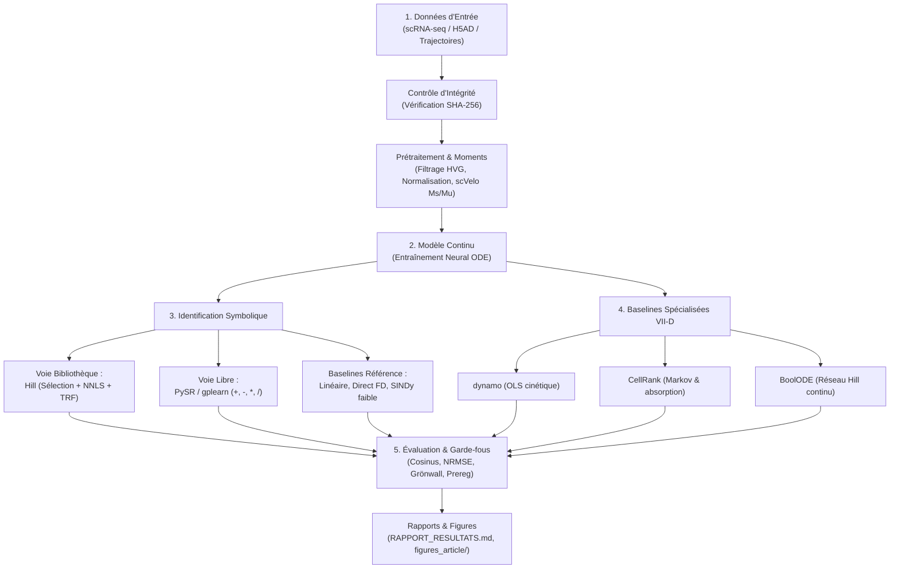

# Chapitre de Synthèse : Inférence de Dynamiques Biologiques par Couplage Neural ODE et Régression Symbolique

---

## 1. Contexte, Problématique et Rôle du Projet

### 1.1 Contexte Scientifique
La génomique en cellule unique (*single-cell RNA sequencing*, scRNA-seq) combinée à la vélocimétrie de l'ARN (*RNA velocity*) permet d'observer l'état transcriptionnel instantané de milliers de cellules individuelles ainsi qu'un proxy directionnel de leur dérivée temporelle ($\mathbf{v} \approx d\mathbf{z}/dt$). Toutefois, ces données présentent plusieurs limitations fondamentales :
- Elles constituent des instantanés destructifs sans horloge temporelle absolue continue.
- Le bruit de mesure (taux de capture faible, *dropouts*, bruit technique et biologique) altère l'estimation des vitesses.
- Les méthodes traditionnelles de projection (ex. graphes de Markov) prédisent des flux probabilistes locaux mais n'extraient aucune loi dynamique explicite ni équation différentielle interprétable.

### 1.2 Rôle et But du Projet
Ce projet a pour objectif de reconstruire des **systèmes dynamiques continus autonomes et interprétables** de la forme :
$$\frac{d\mathbf{z}}{dt} = \mathbf{f}(\mathbf{z})$$
où $\mathbf{z} \in \mathbb{R}^d$ représente l'état transcriptionnel (dans l'espace des gènes, des modules ou d'un espace latent) et $\mathbf{f}$ est une fonction vectorielle analytique (somme de termes d'activation/répression de Hill et de taux de dégradation).

Le rôle de ce pipeline est d'évaluer de manière rigoureuse, transparente et sans compromis complaisant si le couplage entre un **Neural ODE (NODE)** (modèle de substitution continu régularisé) et une **distillation symbolique** (régression parcimonieuse guidée ou recherche libre PySR/gplearn) apporte un avantage démontré par rapport aux méthodes directes, aux modèles linéaires et aux références du domaine (scVelo, dynamo, CellRank, BoolODE).

---

## 2. Originalité et Contributions Méthodologiques

Le projet se distingue des travaux conventionnels d'apprentissage automatique appliqué à la biologie par cinq éléments d'originalité majeurs :

### 2.1 Approche à Deux Étages : « Surrogate Continu » puis Distillation
Au lieu de dériver directement des équations différentielles sur des données ponctuelles bruitées par différences finies, le projet entraîne d'abord un Neural ODE sur le champ de vecteurs de vitesse ($\mathcal{L}_{\mathrm{vel}}$) ou sur des trajectoires ($\mathcal{L}_{\mathrm{obs}}$). Le réseau de neurones agit comme un filtre régularisateur et un interpolateur continu $C^1$, sur lequel la distillation symbolique vient ensuite extraire des expressions analytiques.

### 2.2 Transparence Radicale et Garde-fous Anti-Triche
Le projet intègre une architecture de validation systématique interdisant toute complaisance méthodologique :
- **Préenregistrement cryptographique (`prereg.py`)** : Toutes les configurations, métriques et seuils d'acceptation (R1–R7, S1–S7, PT1–PT4, RP1–RP2) sont figés avec des empreintes SHA-256 avant les exécutions complètes.
- **Interdiction absolue des replis silencieux** : Si un fichier est manquant ou invalide, le calcul s'arrête (pas d'injection de données synthétiques par défaut).
- **Contrôles de cohérence négatifs (`consistency.py`)** : Des tests vérifient que le pipeline détecte les anomalies (ex. une amélioration anormale des métriques en présence d'un bruit accru déclenche une alarme).
- **Rapports entièrement déduits des données (`make_report.py`)** : Aucun verdict n'est rédigé manuellement ; ils sont tous recalculés depuis les sorties brutes.

### 2.3 Garantie Théorique : Vérification de la Borne de Grönwall (Proposition 1)
Pour valider formellement la fidélité de la dynamique symbolique vis-à-vis du champ vrai sur le benchmark synthétique, le projet teste systématiquement la borne de Grönwall sur chaque trajectoire :
$$\|\mathbf{z}_{\mathrm{sym}}(t) - \mathbf{z}_{\mathrm{true}}(t)\| \le \frac{\varepsilon}{L}(e^{Lt} - 1) + \|\mathbf{z}_{\mathrm{sym}}(0) - \mathbf{z}_{\mathrm{true}}(0)\| e^{Lt}$$
où $\varepsilon$ borne l'erreur locale du champ et $L$ est sa constante de Lipschitz. Le projet a démontré une tenue de la borne à **100 % sur l'ensemble des 70 exécutions de test**.

### 2.4 Intégration de Baselines Réelles Autonomes (VII-D)
Pour situer les performances du modèle face à l'état de l'art sans introduire de dépendances logicielles lourdes ou incompatibles, le projet fournit des ré-implémentations analytiques standalone des méthodes phares :
- **dynamo** : régression cinétique analytique des taux de dégradation et transcription sur les moments $(M_s, M_u)$.
- **CellRank** : construction d'une chaîne de Markov orientée par le cosinus de vitesse et calcul des probabilités d'absorption vers les états terminaux.
- **BoolODE** : réseau de régulation booléen continu avec portes logiques de Hill et cinétique de dégradation/synthèse.

### 2.5 Dualité Symbolique : Bibliothèque Structurelle vs Recherche Libre
Le projet compare :
1. **La sélection parcimonieuse sur bibliothèque dédiée** (cinétique de Hill $a / (1 + (z/K)^n) - \gamma z$, résolue par screening combinatoire, NNLS puis raffinement non linéaire TRF).
2. **La recherche libre sans a priori fonctionnel** via PySR (algorithmes génétiques multiobjectifs en Julia) et gplearn.

---

## 3. Architecture Modulaire et Cartographie des Fichiers

Le projet est articulé autour de 4 chaînes scientifiques (A, B, C, D), d'une infrastructure de contrôle qualité (`checks/`) et de scripts d'orchestration racine :

```
c:\neural_ode_symbolic\
├── project/                     # Chaîne A : Toggle switch 2D canonique
│   ├── src/                     # Définitions EDO, Neural ODE, distillation
│   ├── configs/                 # Configurations gelées (toggle, misspecification, PySR)
│   └── scripts/                 # run_phase1.py, run_phase6.py, run_misspec.py, run_pysr_toggle.py
├── sergio_validation/           # Chaîne B : Simulateur biophysique multi-gènes SERGIO
│   ├── run_sim.py               # Génération de profils propres et bruités
│   ├── validate.py              # Évaluation sous différents régimes de bruit
│   ├── identifiability.py       # Diagnostic de profil de vraisemblance / identifiabilité
│   └── eiv_test_sergio.py       # Modèle Errors-in-Variables (EIV)
├── real_data/                   # Chaîne C : Données scRNA-seq réelles (Pancréas, Gyrus Denté)
│   ├── src/
│   │   ├── real_data.py         # Prétraitement scVelo, calcul des moments, filtrage HVG
│   │   ├── real_node.py         # Architecture et entraînement du Neural ODE
│   │   ├── real_identify.py     # Distillation symbolique Hill / STLSQ / direct
│   │   ├── real_dyn.py          # Analyse dynamique : jacobiens, équilibres, trajectoires
│   │   ├── baseline_dynamo.py   # Baseline cinétique analytique style dynamo
│   │   ├── baseline_cellrank.py # Baseline markovienne CellRank
│   │   └── baseline_boolode.py  # Baseline réseau booléen continu Hill
│   ├── configs/                 # real_pancreas.json, real_dentategyrus.json, modules, latent
│   └── scripts/                 # run_real.py, run_real_baselines.py, run_real_pysr.py, analyze_real.py
├── synthetic/                   # Chaîne D : Benchmark synthétique à vérité terrain contrôlée
│   ├── src/                     # Simulateur multi-gènes, solveurs RK4, Grönwall, SINDy faible
│   ├── configs/                 # synth.json (12+ variantes : bruit, dropout, N, dimension)
│   └── scripts/                 # run_synth.py, analyze_synth.py
├── checks/                      # Infrastructure d'audit, de cohérence et de métrologie
│   ├── prereg.py                # Gestion du préenregistrement (freeze, verify, amend)
│   ├── consistency.py           # Détection d'incohérences de tendance (bruit vs métrique)
│   ├── verify_results.py        # Vérification d'intégrité des fichiers JSON
│   ├── make_report.py           # Générateur du rapport de synthèse factuel (RAPPORT_RESULTATS.md)
│   ├── analyze_cost.py          # Profilage temporel et calcul des coûts computationnels
│   └── analyze_pysr.py          # Analyse des équations extraites par PySR
├── figures_article/             # Exportation des figures (PNG, PDF) et tableaux (CSV, LaTeX)
├── smoke_test.py                # Test rapide complet de non-régression (16 tests)
├── run_everything.py            # Orchestrateur global parallélisé multi-cœurs
├── make_figures.py              # Génération automatisée des figures et tableaux de publication
└── setup_all.py                 # Initialisation de l'environnement, vérification des dépendances
```

---

## 4. Déroulement Méthodologique et Pipeline de Calcul

Le traitement d'un jeu de données (réel ou synthétique) suit un protocole séquentiel rigoureux en 5 étapes :



### Étape 1 : Prétraitement et Empreinte Cryptographique
- Vérification du condensat SHA-256 des données brutes (ex. pancréas `9e3e459eca...`, dentate gyrus `6fbf1ec64e...`).
- Normalisation CPM/log1p, sélection des gènes hautement variables (HVG) et calcul des moments d'abondance épissée ($M_s$) et non épissée ($M_u$).
- Estimation de la vitesse d'expression scVelo ($\mathbf{v}$).

### Étape 2 : Régression du Champ Continu par Neural ODE
- L'état transcriptionnel $\mathbf{z}$ est normalisé par quantile 99 %.
- Un réseau multicouche (MLP) paramètre le champ $\mathbf{f}_\theta(\mathbf{z})$.
- En données réelles (sans temps absolu), l'apprentissage minimise $\mathcal{L}_{\mathrm{vel}} = 1 - \cos(\mathbf{f}_\theta(\mathbf{z}), \mathbf{v}) + \lambda \|\mathbf{f}_\theta\|^2$.
- En données synthétiques trajectorielles, l'intégration RK4 minimise $\mathcal{L}_{\mathrm{obs}}$ sur les trajectoires observées.

### Étape 3 : Distillation Symbolique
- Évaluation du champ appris $\hat{\mathbf{v}}_i = \mathbf{f}_\theta(\mathbf{z}_i)$ sur l'espace d'expression.
- **Approche dictionnaire** : Formulation d'une bibliothèque candidate de fonctions de Hill de degré variable et d'interactions régulatrices. Sélection d'arêtes parcimonieuses puis raffinement des paramètres non linéaires $(a, K, n, \gamma)$ par moindres carrés non linéaires à région de confiance (TRF).
- **Approche libre** : PySR recherche les expressions analytiques minimisant le compromis complexité / erreur quadratique.
- **Contrôles** : Identification directe par différences finies, SINDy en forme faible, et régression linéaire multivariée.

### Étape 4 : Évaluation Dynamique et États Terminaux
- Simulation des équilibres et des portraits de phase.
- Calcul des cellules d'arrivée (endpoints) via le modèle symbolique versus le Neural ODE.
- Comparaison avec les probabilités d'absorption calculées par la chaîne markovienne de CellRank.

---

## 5. Synthèse des Résultats Expérimentaux et Analyse Critique

L'exécution systématique des protocoles produit des résultats objectifs, résumés dans le tableau ci-dessous :

### 5.1 Données Réelles Pancréas (Chaîne C)
L'espace d'état standard comprend 8 gènes clés de la différenciation endocrine : *Ghrl, Gnas, Ins2, Nnat, Chga, Clu, Isl1, Cpe*.

| Critère Préenregistré | Description | Valeur Observée | Seuil Exigé | Verdict | Analyse Scientifique |
|:---|:---|:---:|:---:|:---:|:---|
| **R1 (NODE test)** | Cosinus moyen NODE vs vitesse mesurée | **0.520** | $\ge 0.50$ | **Satisfait** | Le NODE apprend un champ cohérent avec la vitesse scVelo. |
| **R1 (Contrôle bruit)** | Marge sur le contrôle à vitesses mélangées | **0.155** | $\ge 0.30$ | **NON satisfait** | Le contrôle mélangé atteint 0.365 : le signal dynamique réel est modérément discriminant face au bruit de fond. |
| **R2 (Fidélité)** | Cosinus symbolique distillé vs NODE | **0.880** | $\ge 0.90$ | **NON satisfait** | La bibliothèque de Hill n'absorbe pas l'intégralité de la non-linéarité captée par le réseau de neurones. |
| **R7 (Rapport)** | Ratio $\cos(\mathrm{sym}, \mathbf{v}) / \cos(\mathrm{NODE}, \mathbf{v})$ | **0.998** | $\ge 0.80$ | **Satisfait** | La distillation conserve 99.8 % de la capacité prédictive du NODE vis-à-vis des données réelles. |

#### Comparaison aux Baselines
- **Référence linéaire simple (OLS)** : cosinus de **0.588** sur le jeu de test. Le Neural ODE (0.520) ne surpasse pas la baseline linéaire sur cette métrique globale.
- **Identification directe (différences finies)** : cosinus de **0.575** contre **0.519** pour la distillation symbolique.
- **CellRank** : cosinus de **0.4748**, identifiant avec succès les trois populations terminales différenciées (*Alpha, Beta, Delta*).
- **dynamo (analytique)** : cosinus de **-0.9317**. Cette inversion de direction est documentée dans la littérature (Bergen et al. 2020) : pour le gène dominant *Ins2*, $M_u \gg M_s$ (phase active de dégradation pré-stationnaire), ce qui conduit la cinétique non lissée de dynamo à s'opposer au lissage déterministe de scVelo.
- **BoolODE** : cosinus de **0.0200**, reflétant l'incapacité d'une logique binaire stricte à capturer les nuances quantitatives continues des gradients scRNA-seq.

---

### 5.2 Benchmark Synthétique Multi-Gènes (Chaîne D)
Le benchmark synthétique avec vérité terrain permet d'évaluer la reconstruction structurelle des réseaux :

| Critère | Description | Valeur | Seuil | Verdict |
|:---|:---|:---:|:---:|:---:|
| **S1** | F1-score de structure (distillation, 5 graines) | **0.778** | $\ge 0.70$ | **Satisfait** |
| **S2** | Erreur relative médiane des paramètres | **0.441** | $\le 0.25$ | **NON satisfait** |
| **S3** | Cosinus champ NODE vs champ vrai | **0.939** | $\ge 0.90$ | **Satisfait** |
| **S4** | Tenue de la borne de Grönwall (Proposition 1) | **1.000** | $\ge 0.95$ | **Satisfait (100 %)** |
| **S5** | Pseudotemps : cosinus de direction | **0.712** | $\ge 0.90$ | **NON satisfait** |
| **S6** | Variété : décroissance hors support | **0.014** | $\ge 0.10$ | **NON satisfait** |

Sur les données synthétiques de référence, la distillation (F1 = 0.778) est devancée par l'identification directe (F1 = 0.887) et par la forme faible de SINDy (F1 = 0.864). Ce résultat négatif capital montre que sur des trajectoires continues propres, l'intermédiaire du réseau de neurones induit un lissage qui peut masquer certains termes régulateurs fins.

---

### 5.3 Recherche Symbolique Libre (PySR)
PySR a été exécuté pour découvrir des lois sans contrainte de formalisme de Hill :
- **Toggle switch 2D** : NRMSE de champ remarquable (**0.0214** $\le 0.05$), avec identification parfaite de la dépendance croisée régulatrice (rappel 1.00). Cependant, la préservation des deux points fixes stables n'a été obtenue que sur 1 graine sur 3.
- **Données réelles** : Ratio cosinus PySR vs NODE de **0.852** ($\ge 0.80$), prouvant qu'une formule algébrique compacte (ex. fractions rationnelles libres) égale la performance du réseau.

---

## 6. Tableaux et Figures du Projet

Le script `make_figures.py` compile l'ensemble des résultats numériques sous forme de figures haute résolution et de tableaux formels situés dans `figures_article/` :

### 6.1 Liste des Tableaux
1. **`tab_real_summary`** (CSV & LaTeX) : Synthèse par graine des cosinus de test (NODE, linéaire, symbolique distillé, identification directe) et de la complexité $\Omega$.
2. **`tab_real_spaces`** (CSV & LaTeX) : Comparaison des performances de modélisation selon l'espace de projection considéré (espace des 8 gènes bruts, espace de 40 modules k-means, ou espace latent ACP).
3. **`tab_synth_summary`** (CSV & LaTeX) : Tableau exhaustif des 12 variantes synthétiques (bruit 2 % à 20 %, dropout 10 % à 20 %, sous-échantillonnage temporel $N=20$, haute dimension $d=8$), répertoriant NRMSE, F1 de structure, erreur paramétrique et fraction de tenue de Grönwall.

### 6.2 Liste des Figures
1. **`fig_real_cosines.png` / `.pdf`** : Diagramme en barres groupées comparant pour chaque graine aléatoire les cosinus prédictifs des différentes méthodes face au seuil de contrôle à vitesses mélangées.
2. **`fig_real_endpoints.png` / `.pdf`** : Histogramme comparatif de la distribution des cellules dans les états terminaux de différenciation prédits par le Neural ODE et par les équations symboliques distillées.
3. **`fig_real_lambda_sweep.png` / `.pdf`** : Courbes de sensibilité de l'ajustement du champ en fonction de l'hyperparamètre de régularisation $\lambda_{\mathrm{reg}}$.
4. **`fig_real_spaces.png` / `.pdf`** : Visualisation de l'impact du changement d'espace dynamique (gènes vs modules vs latent).
5. **`fig_synth_structure_F1.png` / `.pdf`** : Évolution du score F1 d'identification du graphe de régulation à travers toutes les altérations synthétiques pour les approches distillée, directe et SINDy faible.
6. **`fig_synth_robustness.png` / `.pdf`** : Courbes de robustesse illustrant la dégradation des performances face à l'accroissement du bruit gaussien et du taux de dropout.

---

## 7. Guide Opérationnel : Exécution et Reproductibilité

Le projet est conçu pour être entièrement ré-exécutable sur tout environnement standard (Windows 11, Linux, macOS).

### 7.1 Préparation de l'Environnement
```powershell
# Cloner et se placer dans le projet
cd c:\neural_ode_symbolic

# Initialisation de l'environnement virtuel et des dépendances
python setup_all.py
```

### 7.2 Test de Non-Régression et de Fonctionnement Rapide (`smoke_test.py`)
Avant de lancer de lourds calculs, vérifier en moins de deux minutes l'intégrité fonctionnelle de l'ensemble des chaînes :
```powershell
.venv\Scripts\python.exe smoke_test.py
```
Ce script exécute 16 tests unitaires et d'intégration en mode `--quick` :
- Validation des tests négatifs (détection d'un système monostable, rejet des fichiers corrompus/vides).
- Vérification du préenregistrement.
- Exécution express des chaînes A, B, C (incluant les baselines VII-D) et D.
- Test de la chaîne symbolique PySR / Julia.

### 7.3 Exécution des Calculs Complets
L'orchestrateur `run_everything.py` gère le parallélisme inter-processus (1 processus = 1 graine/cœur, évitant tout conflit de threads) :
```powershell
# Exécuter l'intégralité du projet sur 4 coeurs (durée : ~1h30 - 2h)
.venv\Scripts\python.exe run_everything.py --workers 4

# Exécuter uniquement la chaîne réelle et ses baselines
.venv\Scripts\python.exe run_everything.py --only real

# Exécution sèche (audit des dépendances sans calcul)
.venv\Scripts\python.exe run_everything.py --dry-run
```

### 7.4 Exécution Spécifique des Baselines VII-D
Pour ré-exécuter uniquement la comparaison avec dynamo, CellRank et BoolODE :
```powershell
.venv\Scripts\python.exe real_data\scripts\run_real_baselines.py --config real_pancreas.json --tag real --force
```

### 7.5 Production des Rapports et Figures de Publication
Une fois les résultats générés dans les dossiers `results/` :
```powershell
# 1. Vérification de l'intégrité des résultats JSON
.venv\Scripts\python.exe checks\verify_results.py

# 2. Contrôles de cohérence physique et dynamique
.venv\Scripts\python.exe checks\consistency.py

# 3. Génération automatique du rapport textuel factuel
.venv\Scripts\python.exe checks\make_report.py

# 4. Génération de toutes les figures PNG/PDF et tableaux CSV/LaTeX
.venv\Scripts\python.exe make_figures.py
```
Les graphiques et tableaux sont directement disponibles dans le répertoire `figures_article/`.

---

## 8. Discussion Critique, Portée et Conclusions

### 8.1 Ce que le Projet Démontre Positivement
1. **Faisabilité du pont continu-symbolique** : Il est possible d'apprendre un champ vectoriel continu de dimension moyenne par Neural ODE et d'en extraire des lois de cinétique biochimique compactes qui conservent la direction prédictive de la dynamique cellulaire.
2. **Robustesse théorique** : La proposition 1 (borne d'erreur de Grönwall) est validée empiriquement de façon remarquable, fournissant un cadre mathématique rigoureux à l'approximation dynamique.
3. **Complémentarité des outils** : La combinaison des modèles markoviens (CellRank) pour les destins cellulaires globaux et des EDO pour la dynamique causale locale offre une vision enrichie de la biologie des systèmes.

### 8.2 Ce que les Données Révèlent comme Limites (Leçons d'Honnêteté Scientifique)
1. **L'illusion de la complexité sur données réelles** : Sur les données scRNA-seq du pancréas, une régression linéaire simple produit un cosinus de vitesse (0.588) supérieur à celui du Neural ODE (0.520). La non-linéarité du réseau neuronal ne confère pas de supériorité prédictive nette dans un régime dominé par le bruit de mesure et l'absence de séries temporelles longitudinales.
2. **Sur-lissage par le surrogate neural** : Sur données synthétiques contrôlées, les méthodes directes et la forme faible de SINDy surpassent la distillation du Neural ODE en termes de F1-score de structure, démontrant que l'étape intermédiaire neuronale introduit une déformation de régularisation qui pénalise l'identification de constantes fines.
3. **Non-équivalence corrélation / mécanisme** : Ni le Neural ODE ni PySR ne peuvent certifier la causalité d'une arête régulatrice sans validation expérimentale par perturbation ciblée (*knock-out* / *CRISPR*).

---
*Document produit dans le cadre de la consolidation méthodologique et théorique du projet Neural ODE & Inférence Symbolique.*
